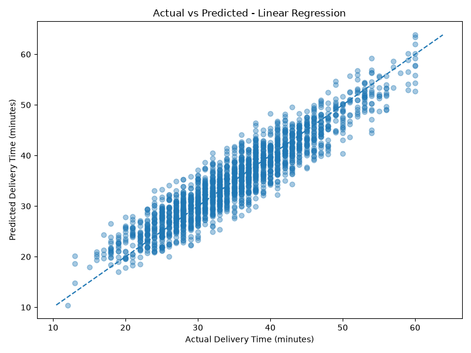

# 🍔 Food Delivery Time Prediction

An end-to-end Machine Learning project that predicts food delivery time using delivery partner details, order information, traffic conditions, weather, vehicle details, and delivery distance.

Built using Python, Scikit-learn, Pandas, and Streamlit.

## 📌 Project Overview

The objective of this project is to develop a Machine Learning model that estimates food delivery time in minutes based on various delivery-related factors.

The project covers the complete Machine Learning workflow:

- Data loading and exploration
- Data preprocessing
- Feature engineering
- Model training
- Model evaluation and comparison
- Best model selection
- Interactive prediction using Streamlit

## 🎯 Project Objectives

- Analyze food delivery data.
- Identify factors affecting delivery time.
- Apply feature engineering techniques.
- Implement and compare multiple regression algorithms.
- Evaluate model performance using appropriate metrics.
- Develop an interactive web application for delivery time prediction.

## 🛠️ Technologies Used

| Technology | Purpose |
|---|---|
| Python | Programming language |
| Pandas | Data manipulation |
| NumPy | Numerical computing |
| Scikit-learn | Machine Learning |
| Matplotlib | Data visualization |
| Seaborn | Statistical visualization |
| Joblib | Model serialization |
| Streamlit | Web application |

## 📂 Project Structure

```text
Food-Delivery-Time-Prediction/
│
├── data/
│   └── custom_food_delivery_dataset.csv
│
├── models/
│   └── delivery_time_model.joblib
│
├── reports/
│   ├── actual_vs_predicted.png
│   └── model_comparison.csv
│
├── src/
│   └── features.py
│
├── app.py
├── main.py
├── train_model.py
├── requirements.txt
├── .gitignore
└── README.md
```

## 📊 Dataset Description

The project uses a custom food delivery dataset containing:

- **Total Records:** 10,000
- **Total Columns:** 22
- **Target Variable:** `Time_taken (min)`

### Important Features

**Numerical Features**
- Delivery partner age
- Delivery partner ratings
- Vehicle condition
- Multiple deliveries
- Delivery distance
- Order date and time features
- Preparation time

**Categorical Features**
- Weather conditions
- Road traffic density
- Type of order
- Type of vehicle
- Festival
- City category

### Data Preprocessing

The following preprocessing techniques are implemented:

- Date and time conversion
- Feature extraction
- Preparation time calculation
- Median imputation for numerical features
- Most-frequent imputation for categorical features
- StandardScaler for numerical features
- OneHotEncoder for categorical features

## ⚙️ Machine Learning Algorithms

Four regression algorithms were implemented and evaluated:

1. Dummy Regressor
2. Linear Regression
3. Random Forest Regressor
4. Extra Trees Regressor

The dataset was divided into:

- Training data: 80%
- Testing data: 20%

The same train-test split was used for all models to ensure a fair comparison.

## 📈 Model Evaluation

The models were evaluated using:

- **MAE:** Mean Absolute Error
- **RMSE:** Root Mean Squared Error
- **R² Score:** Coefficient of Determination

### Model Comparison Results

| Model | MAE | RMSE | R² Score |
|---|---:|---:|---:|
| Linear Regression | **2.47** | **3.08** | **0.8701** |
| Extra Trees | 2.86 | 3.59 | 0.8235 |
| Random Forest | 2.92 | 3.66 | 0.8160 |
| Dummy Baseline | 6.88 | 8.54 | -0.0011 |

### Best Performing Model

**Linear Regression**

- MAE: 2.47 minutes
- RMSE: 3.08 minutes
- R² Score: 0.8701

Linear Regression achieved the lowest MAE among the evaluated models and was selected as the final prediction model.

These results are based on the held-out test set from the included dataset. They should not be interpreted as guaranteed real-world prediction accuracy.

### Actual vs Predicted Visualization



## 🚀 Installation and Setup

Follow these steps to run the project locally.

### 1. Clone the Repository

```bash
git clone https://github.com/Vraj43/Food-Delivery-Time-Prediction.git
```

### 2. Navigate to the Project Directory

```bash
cd Food-Delivery-Time-Prediction
```

### 3. Create a Virtual Environment

```bash
python -m venv .venv
```

### 4. Activate the Virtual Environment

**Windows PowerShell**

```powershell
.\.venv\Scripts\Activate.ps1
```

**Linux / macOS**

```bash
source .venv/bin/activate
```

### 5. Install Dependencies

```bash
pip install -r requirements.txt
```

### 6. Run Data Analysis

```bash
python main.py
```

### 7. Train Machine Learning Models

```bash
python train_model.py
```

This will train the regression models, compare their performance, select the best model, and save the evaluation reports.

### 8. Launch the Streamlit Application

```bash
streamlit run app.py
```

Open the local URL displayed in your terminal, usually:

```text
http://localhost:8501
```

## 💻 Application Features

The Streamlit application allows users to:

- Enter delivery-related information.
- Provide weather and traffic conditions.
- Select vehicle and order details.
- Enter delivery distance and timing information.
- Generate predicted delivery time.

## 📁 Generated Files

After model training, the following files are generated:

| File | Description |
|---|---|
| `delivery_time_model.joblib` | Saved best-performing ML pipeline |
| `model_comparison.csv` | Model evaluation results |
| `actual_vs_predicted.png` | Actual vs predicted visualization |

## 🔮 Future Improvements

- Hyperparameter tuning
- Cross-validation
- Feature importance analysis
- SHAP-based model explainability
- Improved model generalization
- Real-world dataset validation
- Cloud deployment
- Enhanced Streamlit dashboard

## 👨‍💻 Author

**Vraj Patel**

GitHub: [@Vraj43](https://github.com/Vraj43)

Project Repository:

[Food Delivery Time Prediction](https://github.com/Vraj43/Food-Delivery-Time-Prediction)

---

⭐ If you find this project interesting, consider giving the repository a star!
